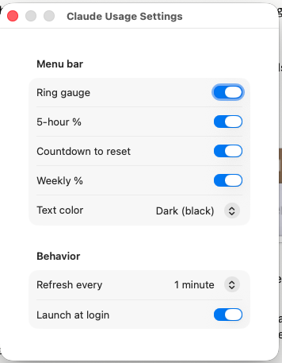

# Claude Usage — macOS Menu Bar

A tiny native macOS menu bar app that shows how much of your **Claude Code subscription
limits** you've used, at a glance — the rolling **5-hour session** window and the **7-day
weekly** window, with reset times. It's the same data the in-app `/usage` command shows,
pulled from the same authenticated endpoint.


Clicking the menu bar item opens a breakdown:

- **5-hour session** — % used and when it resets
- **7-day - All models** — % used and reset date
- **7-day - Model** — per-model weekly usage when Anthropic provides it
- **Extra usage credits** (if enabled on your account)
- Last-updated indicator + **Refresh now**
- **Settings…** and **Quit**

The ring shifts **green → amber → red** as you approach a limit, so you can tell at a
glance whether you're about to get rate-limited or you're fine.

> This shows *limit usage* ("am I about to hit the wall?"), not token/dollar accounting.
> That's the number that actually matters day-to-day, and it's what most existing
> menu bar tools get wrong.

## Requirements

- **macOS 14 (Sonoma) or later**
- **Claude Code** installed and signed in (the app reads the OAuth token Claude Code
  stores in your Keychain — it never manages login itself)
- A Swift toolchain — either full **Xcode** or just the **Command Line Tools**:
  ```sh
  xcode-select --install
  ```
  (This project is intentionally buildable with *only* the Command Line Tools — no Xcode
  project, no Xcode required.)

## Install

```sh
git clone https://github.com/przemekrudzki/claude-usage-menubar.git
cd claude-usage-menubar
./scripts/make-app.sh
cp -R "Claude Usage.app" /Applications/
open "/Applications/Claude Usage.app"
```

`make-app.sh` builds a release binary, wraps it into `Claude Usage.app` (a menu bar
"accessory" app with no Dock icon), and signs it for personal use — with your stable
self-signed identity if you've made one (see below), otherwise ad-hoc.

### First launch

1. **No Keychain prompt expected** — the app reads your token through Apple's
   `/usr/bin/security` tool, the same one Claude Code uses to store it, which is already
   authorized for the **"Claude Code-credentials"** Keychain item. If macOS ever does ask
   anyway, click **Always Allow**.
2. **Launch at login** — enabled automatically on first run, so it comes back after a
   reboot. Toggle it anytime in **Settings**.

If the numbers don't appear, make sure you're signed into Claude Code (run `claude` once
and confirm it works), then choose **Refresh now** from the dropdown.

### Why rebuilds don't re-prompt for the Keychain

The app never calls the Keychain API for the token directly — a per-app grant would be
keyed on the build's code signature (its cdhash, since a personal build has no Team ID)
and would break on **every rebuild**. Instead it shells out to `/usr/bin/security
find-generic-password`, an Apple tool that Claude Code itself uses to create the item and
that is therefore permanently on the item's access list. No prompt, no matter how often
you rebuild.

Optionally, `./scripts/create-signing-cert.sh` (one-time) creates a stable local
self-signed identity so `make-app.sh` produces a consistent code signature across builds —
nice to have, but no longer required for Keychain access. No Apple Developer account
needed either way.

## Settings

Open with **⌘,** or **Settings…** in the dropdown:



- Toggle what shows in the menu bar: **ring**, **5-hour %**, **countdown**, **weekly %**
- **Text color**: Automatic / Light (white) / Dark (black). Pick **Light** if your menu bar
  looks dark because of your wallpaper — macOS can't report that case, so auto-detection
  falls back to the system light/dark mode.
- **Refresh interval**: 30s / 1 min / 5 min
- **Launch at login**

The dropdown always shows the full breakdown regardless of the menu-bar toggles.

## How it works

- On each poll it reads the current OAuth access token from the macOS Keychain item
  `Claude Code-credentials` (created and kept fresh by Claude Code itself), then calls
  `GET https://api.anthropic.com/api/oauth/usage`.
- It parses the returned rate-limit windows (`five_hour` / `seven_day` and the richer
  `limits[]` array). The menu-bar 7-day value always uses the all-model limit, while the
  dropdown also shows model-scoped weekly limits when available.
- **It never manages authentication** and never stores or transmits your token anywhere —
  it only reads the token Claude Code already has and sends it to Anthropic's own API,
  exactly as Claude Code does. No telemetry, no third-party servers, no analytics.
- **Resilient to flaky conditions:** it atomically caches the last-known numbers for offline
  startup, coalesces overlapping refresh triggers, refreshes when the network returns or the
  Mac wakes, and applies bounded retry/backoff when the endpoint or network is unavailable.

## Development

Pure logic lives in the `ClaudeUsageCore` library (no SwiftUI); the SwiftUI views and app
live in the `ClaudeUsage` executable.

```sh
swift build                      # compile
swift run ClaudeUsageCoreTests   # run the test suite
```

Because XCTest and Swift Testing require Xcode, the tests are a small hand-rolled harness
(`TestKit`) run as an executable target — so `swift run ClaudeUsageCoreTests` works with
only the Command Line Tools installed.

```
Sources/
  ClaudeUsageCore/       parsing, Keychain read, HTTP client, polling store (pure, tested)
  ClaudeUsage/           SwiftUI views + @main MenuBarExtra scene
  ClaudeUsageCoreTests/  hand-rolled TestKit harness + checks + fixtures
scripts/                 Info.plist + make-app.sh (bundle + sign) + create-signing-cert.sh
docs/                    design spec, implementation plan, and NOTES.md
```

See [`docs/NOTES.md`](docs/NOTES.md) for the architecture, the non-obvious decisions, and
the gotchas worth knowing before changing anything.

## Caveats

- The `/api/oauth/usage` endpoint is **not a documented public API**. It's the same one
  Claude Code uses internally, but Anthropic could change it at any time and break this app.
- Distributed as source only. The app is **ad-hoc signed**, not notarized — you build and
  sign it locally, which is why Gatekeeper doesn't complain about your own build.
- The token is read via `/usr/bin/security` rather than the Keychain API, so rebuilding
  or updating the app does **not** re-trigger the macOS Keychain permission prompt — see
  [Why rebuilds don't re-prompt for the Keychain](#why-rebuilds-dont-re-prompt-for-the-keychain).
- **Not affiliated with or endorsed by Anthropic.** "Claude" is a trademark of Anthropic;
  this is an unofficial personal utility.

## License

[MIT](LICENSE)
